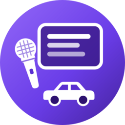

  

<h1 align="center">Auto Lyrics</h1>

  Synced, karaoke-style lyrics for whatever you're playing — on your phone and on <b>Android Auto</b>. 
  Works with Spotify, YouTube Music, Metrolist, Apple Music, Poweramp and most other music apps.

---

## Features

**In the car (Android Auto)**
- **Big lyrics on the now-playing screen** — the current line in large text, the song name small underneath (can be switched off)
- **Lyrics tab** — album art, song and artist, then the current line (▶) and the next 3 lines
- **Sync tab** — nudge the timing for the current song (−0.5s, −0.1s, +0.1s, +0.5s, Reset). Your adjustment is remembered for that song
- Play / pause / skip control the music app the lyrics are following

**On your phone**
- Scrolling synced lyrics with word-by-word karaoke highlighting where available
- Faded album-art background in the album's colours
- Full-screen **Performance mode**
- **Wrong lyrics?** — pick the right lyrics from other search results; your choice is kept for that song
- **Choose music apps** — untick apps you don't want followed (e.g. WhatsApp voice notes, podcasts)
- **Back up & restore** your settings, song timings and picked lyrics
- Optional translation of non-English lyrics into English (off by default)

**Lyrics sources:** [SyncLRC](https://synclrc.tharuk.pro), [LRCLIB](https://lrclib.net) and NetEase Cloud Music. Synced lyrics are always preferred over plain text, and messy titles from YouTube-based apps (several artists, "(Official Video)", "Artist - Song") are cleaned up automatically.

---

## Install

### 1. Download the app
Go to the **[Releases page](../../releases/latest)** and download the `.apk` file (for example `auto-lyrics-1.15.0.apk`) on your phone.

> **Already have the original Auto Lyrics installed?** Uninstall it first. Both apps use the same internal ID, so Android will refuse to install this one over it.

### 2. Install it
Open the downloaded file. If Android asks, allow your browser or file manager to **install unknown apps**, then tap **Install**.

### 3. Give it notification access
Open **Auto Lyrics**, tap the **Grant notification access** button and switch **Auto Lyrics** on.
This is how the app sees which song is playing — it doesn't read or store your notifications.

### 4. Turn on Android Auto's developer mode (needed for the car)
Android Auto only shows apps from the Play Store unless you allow "Unknown sources". Auto Lyrics is installed from GitHub, so you need to turn this on once:

1. **Open Android Auto's settings on your phone.** On most phones: **Settings → Apps → See all apps → Android Auto → Additional settings in the app**.
   (Or search for "Android Auto" in your phone's Settings. On some phones it's under **Connected devices → Android Auto**.)
2. **Scroll right to the bottom** to **Version and permission info**.
3. **Tap Version and permission info about 10 times quickly.**
4. A box appears asking **"Allow development settings?"** — tap **OK**.
5. Tap the **⋮ (three dots)** menu at the top right and choose **Developer settings**.
6. **Scroll down and tick _Unknown sources_.**
7. **Restart your phone**, then connect to your car.

**Auto Lyrics** (the purple icon) now appears in Android Auto's app list. Play music in your usual app, then open Auto Lyrics on the car screen.

> **Tip:** Android Auto updates sometimes switch *Unknown sources* off again. If Auto Lyrics disappears from your car screen, repeat steps 5–7.

### 5. (Optional) Put the music controls on the driver's side
On the car screen open **Settings → Change layout** and choose **Media closer to driver**.

---

## Tips

- **Lyrics a bit early or late?** In the car use the **Sync** tab; on the phone use the delay buttons. It's remembered per song.
- **Your car's audio lags behind your phone?** Set **Car delay** in the phone app's settings — this applies to every song.
- **Wrong lyrics or none at all?** Tap **Wrong lyrics?** on the phone and choose from the list. **Use automatic** undoes your choice.
- **Lyrics follow the wrong app?** Tap **Choose music apps…** in settings and untick it.
- **Reinstalling or changing phones?** Use **Back up settings…** first, then **Restore settings…** afterwards. It keeps your settings, per-song timings and hand-picked lyrics.
- **Old icon still showing?** Restart your phone or reconnect to the car.

---

## Troubleshooting

| Problem | Fix |
|---|---|
| Auto Lyrics isn't in Android Auto | Check *Unknown sources* is still ticked (step 4), restart the phone and reconnect. |
| "App not installed" | Uninstall the original Auto Lyrics (or any older copy signed differently) and try again. |
| No lyrics appear | Make sure notification access is on (step 3), and that the music app is ticked under **Choose music apps…** |
| Shows "More" instead of Lyrics / Sync tabs | Unplug and reconnect, or force-stop Android Auto in your phone's app settings. |

---

## Building it yourself

- Android Studio (or Gradle 8.4), JDK 17, Android SDK 34
- `gradle assembleDebug` builds a debug APK; `gradle testDebugUnitTest` runs the tests
- Every push to `main` is built and tested by GitHub Actions. The first build of each new `versionName` is published automatically as a Release with the APK
- Technical notes for developers are in [DEVELOPMENT.md](DEVELOPMENT.md)

---

## Credits & licence

Forked from **[efrayim-dev/auto-lyrics](https://github.com/efrayim-dev/auto-lyrics)** (MIT). Lyrics come from SyncLRC, LRCLIB and NetEase Cloud Music; all lyrics belong to their respective owners.

This app is not affiliated with Google, Android Auto or any music service.
